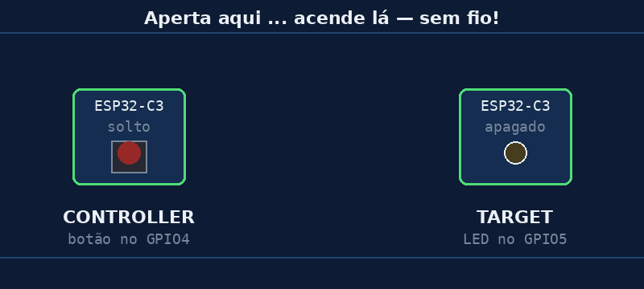

# Aula 01 — Botão numa placa, LED na outra

> *Baseado no trabalho de Noah Teodoro Ceiglinski Domingues · Revisão: Prof. Rogério Malta Branco*

> ⚠️ **Validar antes de publicar:** códigos ainda não testados na bancada.

---

## 🎯 Objetivos

Ao final desta aula você vai:

1. **Ver** duas placas conversando **sem fio**.
2. Apertar um botão numa placa e **acender um LED na outra**.
3. Saber **descobrir o endereço (MAC)** de uma placa e colar no código.

> 💡 Hoje o foco é **ver funcionando**. Não se preocupe em entender cada linha do código: nas próximas aulas vamos desmontar tudo, peça por peça, com calma.

---

## 💭 Conceito

Pense num **controle remoto de portão**. Você aperta o botão aqui, e o portão lá longe abre. Não tem fio ligando os dois: o sinal vai **pelo ar**.

Hoje vamos fazer a mesma coisa com duas placas ESP32:



| Placa | Apelido | O que faz |
|---|---|---|
| A placa do **botão** | **controller** | manda a mensagem |
| A placa do **LED** | **target** | recebe a mensagem e obedece |

O jeito de mandar a mensagem pelo ar se chama **ESP-NOW**. É uma "conversa direta" entre placas ESP32: **não precisa de roteador, nem de internet**.

---

## 🔌 Montagem

> 🛠️ **Esta aula é de bancada.** O Wokwi não consegue simular duas placas conversando por ESP-NOW. Você vai precisar de duas placas de verdade.

### Material

| Quantidade | Item |
|---|---|
| 2 | ESP32-C3 SuperMini |
| 1 | Botão (push-button) |
| 1 | LED (qualquer cor) |
| 1 | Resistor de 220 Ω |
| — | Jumpers e protoboard |
| 2 | Cabos USB-C |

### Placa do botão (controller)

| De | Para |
|---|---|
| Botão (um lado) | **GPIO4** |
| Botão (outro lado) | **GND** |

Não precisa de resistor: vamos usar o **pull-up interno** da placa (você viu isso no MC01).

### Placa do LED (target)

| De | Para |
|---|---|
| **GPIO5** | resistor de 220 Ω |
| resistor | perna **longa** do LED (+) |
| perna **curta** do LED (−) | **GND** |

> ⚠️ **Atenção aos pinos da ESP32-C3 SuperMini:** a placa já tem um LED embutido no **GPIO8**, mas **não use**. Ele funciona "ao contrário" (acende com 0) e o GPIO8 é um pino especial do boot. Também evite os **GPIO2** e **GPIO9**.

*📷 Foto da montagem: em breve.*

---

## 💻 Código

São **dois programas**, um para cada placa. Use o **Thonny**.

### Passo 1 — Grave o target e descubra o MAC

Conecte a **placa do LED** e rode o [`aula01_target.py`](../codigos/aula01_target.py):

```python
import network, espnow
from machine import Pin

# --- 1. Liga o rádio (sem conectar em nenhuma rede) ---
sta = network.WLAN(network.WLAN.IF_STA)
sta.active(False)        # desliga primeiro: garante um começo "limpo"
sta.active(True)         # liga o rádio
sta.disconnect()

# Mostra o "endereço" desta placa. ANOTE e cole no controller!
print("MAC desta placa (target):", sta.config('mac'))

# --- 2. Prepara o ESP-NOW ---
e = espnow.ESPNow()
e.active(True)

# --- 3. O LED ---
led = Pin(5, Pin.OUT)
led.value(0)             # começa apagado

print("[target] esperando mensagens...")

while True:
    mac, msg = e.recv()  # espera chegar uma mensagem
    if msg:              # se chegou algo (e não foi só tempo esgotado)
        print("[target] recebi:", msg)
        if msg == b'1':
            led.value(1)     # acende
        elif msg == b'0':
            led.value(0)     # apaga
```

No Shell do Thonny vai aparecer algo assim:

```
MAC desta placa (target): b'\x1c\xdb\xd4=\x80\xe8'
[target] esperando mensagens...
```

📝 **Copie o MAC** — tudo entre `b'` e `'`, incluindo o `b'` e o `'`.

> 🤔 *Por que tem um `=` no meio?* Algumas partes do endereço o Python mostra como letras ou símbolos. É normal. Copie exatamente como aparece. Vamos entender isso na Aula 03.

### Passo 2 — Grave o controller

Conecte a **placa do botão**. Abra o [`aula01_controller.py`](../codigos/aula01_controller.py) e **troque o MAC** na linha do `TARGET_MAC` pelo que você copiou:

```python
import network, espnow, time
from machine import Pin

# >>> TROQUE pelo MAC que a placa do LED (target) mostrou <<<
TARGET_MAC = b'\xaa\xbb\xcc\xdd\xee\xff'

# --- 1. Liga o rádio (sem conectar em nenhuma rede) ---
sta = network.WLAN(network.WLAN.IF_STA)
sta.active(False)
sta.active(True)
sta.disconnect()

# --- 2. Prepara o ESP-NOW e cadastra o destino ---
e = espnow.ESPNow()
e.active(True)
e.add_peer(TARGET_MAC)   # coloca a outra placa na "agenda"

# --- 3. O botão ---
# PULL_UP: solto = 1, apertado = 0  (lógica invertida!)
botao = Pin(4, Pin.IN, Pin.PULL_UP)

estado_anterior = botao.value()
print("[controller] pronto! aperte o botão")

while True:
    estado = botao.value()

    # só envia quando o botão MUDA (apertou ou soltou)
    if estado != estado_anterior:
        if estado == 0:
            msg = b'1'           # apertado -> manda acender
        else:
            msg = b'0'           # solto    -> manda apagar

        ok = e.send(TARGET_MAC, msg)
        print("[controller] enviei", msg, "-> confirmado:", ok)

        estado_anterior = estado

    time.sleep_ms(20)    # pequena pausa: evita ler o "tremido" do botão
```

### Passo 3 — Aperte o botão! 🎉

Mantenha o botão apertado: o LED da **outra placa** acende. Solte: apaga.

> 💡 **Dica do Thonny:** ele conversa com **uma placa por vez**. Depois de gravar o target, ele pode ficar só ligado no USB (ou num carregador). O programa continua rodando.

---

## 🔬 Experimento

Responda olhando para as placas e para o Shell:

1. Quando você aperta o botão, o que aparece no Shell do **controller**? E quando solta?
2. O que significa `confirmado: True`?
3. **Desligue a placa do LED** e aperte o botão. O que muda no Shell do controller?
4. Afaste as placas: uma em cada lado da sala. Ainda funciona?
5. Troque um número do `TARGET_MAC` de propósito e rode de novo. O que acontece? Por quê?

---

## 🏆 Desafio

**Principal:** faça o botão funcionar como **interruptor**: cada aperto **troca** o LED (apertou uma vez, acende; apertou de novo, apaga).

> Dica: a mudança é só no **controller**. Ele precisa lembrar se o LED está aceso ou apagado e mandar o contrário quando o botão for **apertado** (não quando for solto).

**Bônus:** use um **segundo botão** no controller (GPIO6) para fazer o LED **piscar 3 vezes**. Invente uma mensagem nova (por exemplo `b'p'`) e ensine o target a obedecer.

---

## 📌 Resumo

- Duas placas ESP32 podem conversar **pelo ar**, usando **ESP-NOW**.
- **Não precisa** de roteador nem de internet.
- A placa que manda é o **controller**; a que recebe é o **target**.
- Para mandar uma mensagem, o controller precisa saber o **endereço (MAC)** do target.
- As mensagens desta aula são bem curtas: `b'1'` (acende) e `b'0'` (apaga).

---

[← Início](https://rogeriomb-hub.github.io/minicurso_06-embarcados/) | [Aula 02 — Do fio para o ar →](https://rogeriomb-hub.github.io/minicurso_06-embarcados/aulas/aula02-do-fio-para-o-ar)
