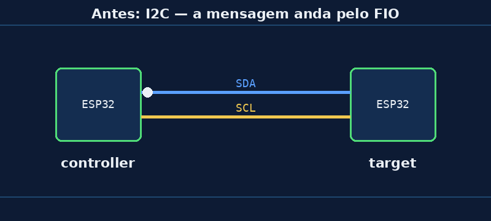

# Aula 02 — Do fio para o ar

> *Baseado no trabalho de Noah Teodoro Ceiglinski Domingues · Revisão: Prof. Rogério Malta Branco*

---

## 🎯 Objetivos

Ao final desta aula você vai saber explicar, com suas palavras:

1. **Por onde** a mensagem viajou na Aula 01.
2. A **diferença** entre conversar por **fio** (I2C) e pelo **ar** (ESP-NOW).
3. **Quando** vale a pena usar cada um.

> 💡 Esta aula **não tem código novo**. Vamos só entender o que já funcionou. Use a mesma montagem da Aula 01 para os experimentos.

---

## 💭 Conceito

### 1. Lembra do I2C?

No **Minicurso 03** você ligou duas placas com **dois fios**: **SDA** (os dados) e **SCL** (o "ritmo", o relógio). Também ligou o **GND** das duas placas. A mensagem andava **dentro do fio**, como água num cano.

### 2. E agora?

Na Aula 01 não tinha **nenhum fio** entre as placas, e mesmo assim o LED acendeu. A mensagem foi **pelo ar**.

### 3. Como assim, "pelo ar"?

Pense num **rádio de pilha**. A rádio da cidade manda o som pelo ar, e o seu radinho "pega" esse som. Ninguém puxou um fio da rádio até a sua casa.

A ESP32 tem um **rádio** dentro dela, o mesmo que ela usa para o Wi-Fi. Quando o controller manda `b'1'`, o rádio transforma essa mensagem em **ondas de rádio** e o rádio do target "pega" essas ondas.

> 📡 Repare na plaquinha: aquela parte com o desenho em zigue-zague (ou a pecinha cerâmica) é a **antena**. É por ela que a mensagem sai e entra.

### 4. ESP-NOW é Wi-Fi?

**Quase.** Usa o **mesmo rádio** do Wi-Fi, mas é uma conversa **direta**, de placa para placa.

| | Wi-Fi da sua casa | ESP-NOW |
|---|---|---|
| Precisa de roteador? | ✅ sim | ❌ não |
| Precisa de senha de rede? | ✅ sim | ❌ não |
| Precisa de internet? | depende | ❌ não |
| Parece com... | ligar pelo **celular** (passa pela operadora) | falar no **walkie-talkie** (direto, de um para o outro) |

### 5. Fio ou ar: comparando

| | I2C (fio) | ESP-NOW (ar) |
|---|---|---|
| Liga as placas com... | fios SDA, SCL e GND | nada! |
| Distância | curta (centímetros, poucos metros) | dezenas de metros |
| Pode atravessar parede? | — | sim, mas o sinal enfraquece |
| Sofre interferência? | pouco | mais (outros rádios, metal, paredes) |
| A mensagem pode se perder? | raramente | **pode**, e por isso existe a confirmação (vamos ver na Aula 07) |

> 🏭 **Na indústria:** fio é mais **confiável**; ar é mais **prático** quando não dá para passar cabo (peça que gira, máquina que se move, sensor longe do painel).

---

## 🔌 Montagem

A mesma da [Aula 01](aula01-botao-led-sem-fio): botão no **GPIO4** do controller e LED no **GPIO5** do target. Grave os mesmos códigos.

---

## 🔬 Experimento

Faça cada teste e anote o que aconteceu. Observe o LED **e** o Shell do controller (`confirmado: True` ou `False`).

1. **Distância:** leve a placa do LED para longe, no fundo da sala e depois no corredor. Até onde funciona?
2. **Mão na antena:** cubra a antena do target com a mão fechada. Muda alguma coisa?
3. **Metal:** coloque o target dentro de uma caneca de metal ou de uma lata. E agora?
4. **Parede:** deixe uma placa em cada sala, com a porta fechada. Funciona?
5. **Pergunta para pensar:** no I2C, se você puxasse o fio SDA, o que aconteceria? Que coisa parecida com isso acontece no ESP-NOW?

---

## 🏆 Desafio

**Principal:** escreva **três situações** numa fábrica (ou na sua casa) em que:

- vale **mais a pena usar fio**, e
- vale **mais a pena usar o ar**.

Explique cada escolha em uma frase.

**Bônus:** pesquise que outros aparelhos da sua casa usam a mesma faixa de rádio da ESP32 (**2,4 GHz**). Algum deles poderia atrapalhar o ESP-NOW?

---

## 📌 Resumo

- No **I2C** a mensagem anda pelo **fio**; no **ESP-NOW**, pelo **ar**, como ondas de rádio.
- A ESP32 tem um **rádio** e uma **antena**, os mesmos do Wi-Fi.
- ESP-NOW é uma conversa **direta** entre placas: **sem roteador**, sem senha, sem internet.
- Pelo ar é mais **prático**, mas a mensagem **pode se perder**: distância, paredes e metal atrapalham.

---

[← Aula 01 — Botão e LED sem fio](https://rogeriomb-hub.github.io/minicurso_06-embarcados/aulas/aula01-botao-led-sem-fio) | [Aula 03 — O endereço MAC →](https://rogeriomb-hub.github.io/minicurso_06-embarcados/aulas/aula03-endereco-mac)
