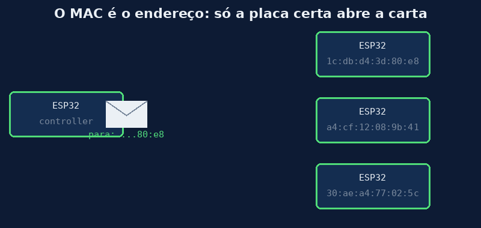

# Aula 03 — O endereço MAC

> *Baseado no trabalho de Noah Teodoro Ceiglinski Domingues · Revisão: Prof. Rogério Malta Branco*

---

## 🎯 Objetivos

Ao final desta aula você vai:

1. Saber **o que é** o endereço MAC e **para que** ele serve.
2. **Ler o MAC** da sua placa com um programa bem curto.
3. Entender **por que** o MAC aparece "estranho" no Shell (com `=`, letras e `\x`).

---

## 💭 Conceito

### 1. Toda carta precisa de endereço

Na Aula 02 vimos que a mensagem vai **pelo ar**. Mas aí aparece um problema: na sala pode ter **várias** placas ligadas. Como a mensagem sabe **para qual** delas ela vai?

Pense numa **carta pelo correio**. No envelope tem o **endereço**. O carteiro passa por várias casas, mas só entrega naquela que tem o endereço certo.



### 2. O MAC é o "CPF" da placa

Cada ESP32 sai da fábrica com um endereço **gravado** dentro dela. Esse endereço se chama **MAC** (*Media Access Control*).

- Ele é **único**: não existem duas placas com o mesmo MAC.
- Ele **já vem pronto**: você não escolhe, só descobre qual é.
- Ele tem **6 bytes**.

Foi por isso que, na Aula 01, você precisou **copiar o MAC do target** e colar no controller: o controller precisava saber **para quem** mandar a carta.

### 3. Como um MAC é escrito

Em etiquetas, roteadores e manuais, o MAC costuma aparecer assim, em **hexadecimal**, separado por `:`

```
1c:db:d4:3d:80:e8
```

São **6 pedaços**, um para cada byte. Lembra do hexadecimal do MC01? Cada pedaço vai de `00` a `ff` (0 a 255).

### 4. E por que no Shell aparece "estranho"?

No Thonny, o MAC aparece assim:

```
b'\x1c\xdb\xd4=\x80\xe8'
```

É o **mesmo endereço**! Repare, pedaço por pedaço:

| Byte | Jeito bonito | Como o Python mostra | Por quê |
|---|---|---|---|
| 1º | `1c` | `\x1c` | não é letra: mostra o hexa com `\x` |
| 2º | `db` | `\xdb` | idem |
| 3º | `d4` | `\xd4` | idem |
| 4º | `3d` | **`=`** | `3d` é o código do sinal **`=`** na tabela ASCII, então o Python mostra o sinal! |
| 5º | `80` | `\x80` | não é letra |
| 6º | `e8` | `\xe8` | não é letra |

> 💡 **Regra do Python:** se o byte for o código de uma letra, número ou sinal que dá para ver, ele mostra o **caractere**. Se não for, mostra `\x` + o hexadecimal.
>
> Por isso, ao copiar o MAC para o código, **copie exatamente como aparece**, com `b'` no começo, `'` no fim, e o `=` (ou letra) no meio.

---

## 🔌 Montagem

**Nenhuma!** Basta **uma** placa ligada no USB.

> 🖥️ **Wokwi:** este programa também pode ser testado no simulador (ESP32 simples), porque usa só uma placa. O MAC que aparece lá é "de mentira", inventado pelo simulador.

---

## 💻 Código

Abra o [`aula03_ler_mac.py`](../codigos/aula03_ler_mac.py) no Thonny.

### Pedaço 1 — Ligar o rádio

```python
import network

sta = network.WLAN(network.WLAN.IF_STA)
sta.active(True)
```

O MAC "mora" no rádio, então primeiro ligamos o rádio. **Não** conectamos em nenhuma rede.

### Pedaço 2 — Pegar o MAC

```python
mac = sta.config('mac')      # pega o endereço da placa (6 bytes)
print("Para colar no código:", mac)
print("Tamanho:", len(mac), "bytes")
```

`sta.config('mac')` devolve os 6 bytes. É **este** formato (`b'...'`) que vai no código do controller.

### Pedaço 3 — Mostrar do jeito bonito

```python
partes = []
for b in mac:                     # passa por cada byte
    partes.append("%02x" % b)     # escreve em hexadecimal, sempre com 2 dígitos
print("Jeito bonito:", ":".join(partes))
```

- `for b in mac` → pega **um byte por vez** (como um número de 0 a 255).
- `"%02x" % b` → escreve o número em **hexa**, sempre com **2 dígitos** (`3d`, não `3d0` nem `d`).
- `":".join(partes)` → junta os pedaços com `:` no meio.

### Resultado esperado

```
Para colar no código: b'\x1c\xdb\xd4=\x80\xe8'
Tamanho: 6 bytes
Jeito bonito: 1c:db:d4:3d:80:e8
```

*(O seu MAC vai ser diferente: cada placa tem o seu!)*

---

## 🔬 Experimento

1. Rode o programa na **sua** placa. Compare o MAC com o do colega do lado. São iguais?
2. Rode na **outra** placa do seu kit. O MAC mudou?
3. Desligue a placa, ligue de novo e rode outra vez. O MAC mudou? Por quê?
4. No "jeito Python" do seu MAC, aparece alguma **letra ou sinal** no meio? Qual byte é esse? Confira na tabela ASCII.
5. Lembre da Aula 01: o que acontece se o controller tiver o MAC **errado**? Explique com a ideia da carta.

---

## 🏆 Desafio

**Principal:** escreva no papel o seu MAC no **jeito bonito** e, ao lado, transforme cada pedaço em **decimal**. (Exemplo: `1c` → 28.)

**Bônus:** existe um endereço especial, `ff:ff:ff:ff:ff:ff`, chamado de **broadcast** ("para todos"). Usando a ideia da carta, o que você acha que acontece com uma mensagem mandada para esse endereço? *(Vamos usar isso mais para frente!)*

---

## 📌 Resumo

- O **MAC** é o endereço único de cada placa: um "CPF" gravado de fábrica.
- Ele tem **6 bytes**, e normalmente é escrito em hexa separado por `:` (ex.: `1c:db:d4:3d:80:e8`).
- Para descobrir: `sta.config('mac')`, com o rádio ligado.
- No Python, ele aparece como `b'...'`, com `\x` e às vezes **letras ou sinais** no meio. É o mesmo endereço!
- No ESP-NOW, o controller precisa do MAC do target para saber **para quem** mandar.

---

[← Aula 02 — Do fio para o ar](https://rogeriomb-hub.github.io/minicurso_06-embarcados/aulas/aula02-do-fio-para-o-ar) | [Aula 04 — Preparando o rádio →](https://rogeriomb-hub.github.io/minicurso_06-embarcados/aulas/aula04-preparando-o-radio)
