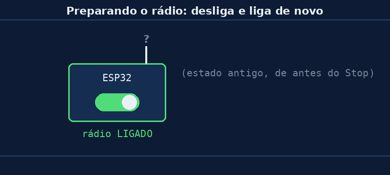

# Aula 04 — Preparando o rádio

> *Baseado no trabalho de Noah Teodoro Ceiglinski Domingues · Revisão: Prof. Rogério Malta Branco*

---

## 🎯 Objetivos

Ao final desta aula você vai:

1. Saber **o que fazem** as 4 primeiras linhas dos programas da Aula 01.
2. Entender **por que** desligamos o rádio antes de ligar.
3. Ver o **erro** que aparece quando o rádio não está pronto.

> 💡 A partir desta aula começa a **Seção 2**: vamos desmontar o código da Aula 01, **uma peça por aula**. Hoje, a primeira peça.

---

## 💭 Conceito

### 1. Relembrando

Lá no começo dos dois programas da Aula 01 tinha isto:

```python
sta = network.WLAN(network.WLAN.IF_STA)
sta.active(False)
sta.active(True)
sta.disconnect()
```

Parece estranho, né? **Desligar** e logo depois **ligar**? Vamos entender linha por linha.

### 2. Antes de falar no walkie-talkie...

...você precisa **ligar** o walkie-talkie. 📻

Com a ESP32 é igual: o ESP-NOW usa o **rádio** da placa (Aula 02). Se o rádio estiver desligado, a mensagem não sai. Essas 4 linhas são o "ligar o walkie-talkie".

### 3. Linha por linha

| Linha | O que faz | Analogia |
|---|---|---|
| `sta = network.WLAN(network.WLAN.IF_STA)` | Cria o **controle** do rádio, no modo **estação** (STA) | pegar o walkie-talkie na mão |
| `sta.active(False)` | **Desliga** o rádio | desligar o aparelho |
| `sta.active(True)` | **Liga** o rádio | ligar de novo |
| `sta.disconnect()` | Garante que ele **não** está tentando entrar numa rede Wi-Fi | não deixar ele "procurando sinal" de outra coisa |

> 📖 **STA** vem de *station* (estação): é o modo em que a placa funciona como um **aparelho comum**, igual ao seu celular quando ele usa o Wi-Fi. Existe também o modo **AP** (*access point*), em que a placa vira um "roteador". Para o ESP-NOW, usamos o **STA**.

### 4. Por que desligar antes de ligar?



Quando você aperta **Stop** no Thonny e roda de novo, a placa faz um **reinício leve** (*soft reset*). O programa recomeça do zero... **mas o rádio não!** Ele continua do jeito que estava antes, podendo estar ligado, desligado ou "pela metade".

É como um computador travado: às vezes o jeito mais seguro é **desligar e ligar de novo**. 😄

Fazendo `active(False)` e depois `active(True)`, a gente garante que o rádio começa **sempre do mesmo jeito**, não importa o que aconteceu antes.

### 5. E o `disconnect()`?

Se a placa já foi usada para entrar numa rede Wi-Fi, ela pode tentar **se conectar sozinha** de novo. Quando ela se conecta a um roteador, o rádio muda de **canal**. Se cada placa estiver num canal diferente, elas **não se escutam**.

Pense em **dois walkie-talkies em canais diferentes**: os dois estão ligados, mas um não ouve o outro. O `disconnect()` evita isso.

> 🔑 **Regra de ouro:** no ESP-NOW, as duas placas precisam estar no **mesmo canal**.

---

## 🔌 Montagem

**Nenhuma!** Basta **uma** placa no USB.

---

## 💻 Código

Abra o [`aula04_preparar_radio.py`](../codigos/aula04_preparar_radio.py) no Thonny. Ele faz as mesmas 4 linhas, mas **mostra o que acontece** em cada passo.

```python
import network

# 1) Cria o "controle" do rádio, no modo ESTAÇÃO (STA)
sta = network.WLAN(network.WLAN.IF_STA)
print("1) Rádio ligado agora?", sta.active())

# 2) Desliga: apaga qualquer estado antigo
sta.active(False)
print("2) Depois do active(False):", sta.active())

# 3) Liga de novo: rádio "limpo", pronto para usar
sta.active(True)
print("3) Depois do active(True): ", sta.active())

# 4) Garante que NÃO está tentando entrar numa rede Wi-Fi
sta.disconnect()
print("4) Conectado a alguma rede?", sta.isconnected())

# 5) Curiosidade: em qual "canal" o rádio está?
print("5) Canal do rádio:", sta.config('channel'))
```

Repare: `sta.active()` **sem nada dentro** dos parênteses **pergunta** se o rádio está ligado. **Com** `True` ou `False`, ele **manda** ligar ou desligar.

### Resultado esperado

Na **primeira** vez que você roda (logo depois de ligar a placa):

```
1) Rádio ligado agora? False
2) Depois do active(False): False
3) Depois do active(True):  True
4) Conectado a alguma rede? False
5) Canal do rádio: 1
```

---

## 🔬 Experimento

1. Rode o programa. Anote o que aparece na linha **1)**.
2. Aperte **Stop** e rode **de novo**. A linha **1)** mudou? Por quê? *(Dica: releia a parte 4 do Conceito.)*
3. Desconecte o USB, conecte de novo e rode. E agora, o que aparece na linha **1)**?
4. **Provocando o erro:** abra o `aula01_controller.py` e coloque um `#` na frente da linha `sta.active(True)` (assim ela não roda). Desconecte e reconecte a placa e rode. Que mensagem de erro aparece? Em qual linha?
5. Tire o `#` e rode de novo. Voltou a funcionar?

> 🧩 No item 4, o erro deve ter algo como `ESP_ERR_ESPNOW_IF`. Traduzindo: *"erro do ESP-NOW: problema na interface"*, ou seja, **o rádio não está pronto**. Guarde esse nome: se um dia aparecer, você já sabe onde olhar!

---

## 🏆 Desafio

**Principal:** escreva com suas palavras, em **uma frase cada**, para que servem:

- `sta.active(False)`
- `sta.active(True)`
- `sta.disconnect()`

**Bônus:** rode o programa nas **duas** placas do seu kit e compare o **canal** (linha 5). São iguais? O que aconteceria com o ESP-NOW se fossem diferentes?

---

## 📌 Resumo

- O ESP-NOW usa o **rádio** da placa, e ele precisa estar **ligado**.
- `network.WLAN(network.WLAN.IF_STA)` cria o controle do rádio no modo **estação**.
- `active(False)` e depois `active(True)` = **desligar e ligar de novo**, para começar sempre "limpo". Isso é necessário porque o **Stop** do Thonny **não** reinicia o rádio.
- `disconnect()` impede a placa de entrar numa rede Wi-Fi e mudar de **canal**.
- As duas placas precisam estar no **mesmo canal**.
- Rádio desligado → erro **`ESP_ERR_ESPNOW_IF`**.

---

[← Aula 03 — O endereço MAC](https://rogeriomb-hub.github.io/minicurso_06-embarcados/aulas/aula03-endereco-mac) | [Início →](https://rogeriomb-hub.github.io/minicurso_06-embarcados/)
