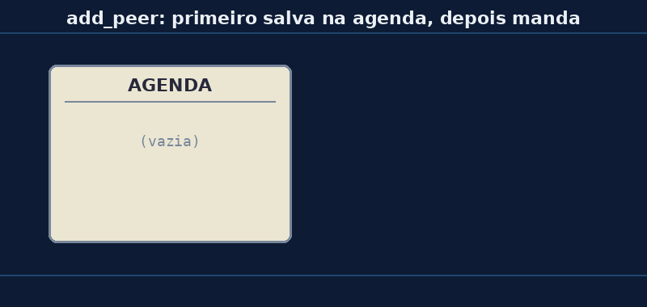

# Aula 05 — `add_peer`: a agenda de contatos

> *Baseado no trabalho de Noah Teodoro Ceiglinski Domingues · Revisão: Prof. Rogério Malta Branco*

---

## 🎯 Objetivos

Ao final desta aula você vai:

1. Saber **o que é** um *peer* e para que serve o `add_peer`.
2. Entender **quem** precisa da agenda: quem **manda** ou quem **recebe**?
3. Reconhecer o **erro** de mandar mensagem para quem não está na agenda.

---

## 💭 Conceito

### 1. Relembrando

No controller da Aula 01, logo depois de preparar o rádio (Aula 04), vinha isto:

```python
e = espnow.ESPNow()
e.active(True)
e.add_peer(TARGET_MAC)
```

As duas primeiras linhas **ligam o ESP-NOW**. Hoje o foco é a **terceira**.

### 2. A agenda do celular

Pense no **WhatsApp**. Para mandar mensagem para alguém, primeiro você precisa **salvar o número** dessa pessoa na agenda. Sem salvar, não tem como escolher para quem mandar.

No ESP-NOW é igual:

- O **número de telefone** é o **MAC** (Aula 03).
- Salvar na agenda é o **`add_peer`**.
- *Peer* (lê-se "pír") quer dizer **colega, parceiro**: é cada placa que está na agenda.



### 3. Quem precisa da agenda?

| Placa | Precisa de `add_peer`? | Por quê |
|---|---|---|
| **controller** (manda) | ✅ **sim** | para **mandar**, precisa ter o destino salvo |
| **target** (recebe) | ❌ não* | para **receber**, basta estar com o ESP-NOW ligado |

Volte no código do target da Aula 01: **não tem** `add_peer` lá! Igual ao celular: você **recebe** mensagem de qualquer um, mesmo de quem não está salvo. 📱

\* *Tem uma exceção: quando a mensagem é criptografada (com senha). Vamos ver isso no fim do curso.*

### 4. O que pode dar errado

| Situação | O que acontece | Erro (parte final do nome) |
|---|---|---|
| Mandar para quem **não está** na agenda | erro! | `..._NOT_FOUND` (não encontrado) |
| Salvar o **mesmo** contato duas vezes | erro! | `..._EXIST` (já existe) |
| Salvar um MAC **errado** | não dá erro… mas a mensagem não chega em ninguém! | — |

> ⚠️ O último caso é o mais traiçoeiro: a placa salva **qualquer** MAC, sem conferir se a placa existe. Se você errou um número, ela vai mandar para o vazio. Lembra do experimento 5 da Aula 01?

---

## 🔌 Montagem

Para os passos 1 a 3, basta **uma** placa no USB.
Para ver o `Confirmado? True` no passo 4, deixe a **placa do target da Aula 01** ligada (com o `aula01_target.py` rodando).

---

## 💻 Código

Abra o [`aula05_agenda.py`](../codigos/aula05_agenda.py) no Thonny e **troque o `TARGET_MAC`** pelo MAC do seu target.

### Pedaço 1 — O começo de sempre

```python
import network, espnow

sta = network.WLAN(network.WLAN.IF_STA)
sta.active(False)
sta.active(True)
sta.disconnect()

e = espnow.ESPNow()
e.active(True)
```

Preparar o rádio (Aula 04) e ligar o ESP-NOW. Isso vai aparecer em **todos** os programas daqui pra frente.

### Pedaço 2 — Dois endereços

```python
TARGET_MAC = b'\xaa\xbb\xcc\xdd\xee\xff'   # o seu target (troque!)
OUTRO_MAC  = b'\x11\x22\x33\x44\x55\x66'   # um MAC que NÃO vamos salvar
```

### Pedaço 3 — Olhar e mexer na agenda

```python
print("1) Agenda no começo:", e.get_peers())

e.add_peer(TARGET_MAC)
print("2) Salvei o target na agenda!")

print("3) Contatos na agenda:", len(e.get_peers()))
```

- `e.get_peers()` → **mostra** a agenda.
- `e.add_peer(MAC)` → **salva** um contato.
- `len(...)` → **conta** quantos contatos tem (lembra do `len` das listas no MC01?).

### Pedaço 4 — Mandar

```python
ok = e.send(TARGET_MAC, b'1')
print("4) Mandei para o target. Confirmado?", ok)

# e.send(OUTRO_MAC, b'1')
```

A última linha está **desligada** com `#`. Vamos ligá-la no experimento.

### Resultado esperado

```
1) Agenda no começo: ()
2) Salvei o target na agenda!
3) Contatos na agenda: 1
4) Mandei para o target. Confirmado? True
Fim!
```

> 💡 `()` quer dizer **vazio**: a agenda começa sem ninguém.
> Se o target **não** estiver ligado, o passo 4 mostra `False`, mas **não dá erro**. Por quê? Veremos na Aula 07!

---

## 🔬 Experimento

1. Rode o programa com o target **ligado**. Deu `True` no passo 4?
2. **Desligue o target** e rode de novo. O que mudou no passo 4?
3. **Tire o `#`** da linha `e.send(OUTRO_MAC, b'1')` e rode. Que erro aparece? Qual a parte final do nome do erro?
4. Coloque o `#` de volta. Agora **copie** a linha `e.add_peer(TARGET_MAC)` e cole logo embaixo dela (ficam duas iguais). Rode. Que erro aparece agora?
5. Apague a linha repetida. Agora **coloque um `#`** na frente do `e.add_peer(TARGET_MAC)`. Rode. O que acontece no passo 4? Explique usando a ideia da agenda.

---

## 🏆 Desafio

**Principal:** modifique o programa para salvar **os dois** MACs (`TARGET_MAC` e `OUTRO_MAC`) e mostrar que a agenda ficou com **2** contatos. Mandar para o `OUTRO_MAC` ainda dá erro? E o resultado é `True` ou `False`? Por quê?

**Bônus:** existe o comando `e.del_peer(MAC)`. O que você acha que ele faz? Teste: salve, apague, e mostre a agenda depois de cada passo.

---

## 📌 Resumo

- *Peer* = **colega**: cada placa salva na agenda do ESP-NOW.
- `e.add_peer(MAC)` **salva** um contato; `e.get_peers()` **mostra** a agenda.
- Quem **manda** precisa ter o destino na agenda. Quem só **recebe**, não.
- Mandar para quem não está na agenda → erro **`..._NOT_FOUND`**.
- Salvar duas vezes o mesmo contato → erro **`..._EXIST`**.
- Salvar um MAC **errado** não dá erro, mas a mensagem não chega.

---

[← Aula 04 — Preparando o rádio](https://rogeriomb-hub.github.io/minicurso_06-embarcados/aulas/aula04-preparando-o-radio) | [Aula 06 — send e recv: a fila →](https://rogeriomb-hub.github.io/minicurso_06-embarcados/aulas/aula06-send-recv-fila)
