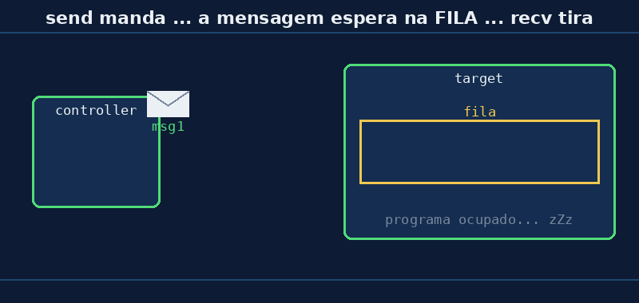

# Aula 06 — `send` e `recv`: a fila de mensagens

> *Baseado no trabalho de Noah Teodoro Ceiglinski Domingues · Revisão: Prof. Rogério Malta Branco*

---

## 🎯 Objetivos

Ao final desta aula você vai:

1. Saber o que fazem o `send` (mandar) e o `recv` (receber).
2. Entender que as mensagens que chegam **esperam numa fila**.
3. Usar o `e.any()` para perguntar **se tem mensagem** esperando.

---

## 💭 Conceito

### 1. Relembrando

Na Aula 01, o controller mandava e o target recebia:

```python
# controller
e.send(TARGET_MAC, msg)

# target
mac, msg = e.recv()
```

Hoje vamos entender o que acontece **entre** essas duas linhas.

### 2. A caixa de correio 📬

O carteiro passa e deixa cartas na sua **caixa de correio**. Você não precisa estar em casa: as cartas **ficam lá esperando**. Quando você chega, abre a caixa e pega **uma por uma**, na ordem em que chegaram.

No ESP-NOW:

| Na vida real | No ESP-NOW |
|---|---|
| O carteiro coloca a carta | o controller faz **`send`** |
| A caixa de correio | a **fila** do target |
| Você pega uma carta | o target faz **`recv`** |
| "Tem carta na caixa?" | **`e.any()`** |



### 3. O `send` — mandar

```python
e.send(TARGET_MAC, "msg 1")
```

- 1º: **para quem** (o MAC, que tem que estar na agenda, como vimos na Aula 05).
- 2º: **o quê** (a mensagem).

A mensagem pode ser um **texto** (`"msg 1"`) ou **bytes** (`b'1'`). Ela pode ter até **250 caracteres**: é para recados curtos!

### 4. O `recv` — receber

```python
mac, msg = e.recv()
```

O `recv` tira **uma** mensagem da fila e devolve **duas coisas**:

- `mac` → **quem mandou** (o MAC de quem enviou).
- `msg` → **a mensagem**.

> ⚠️ A mensagem **sempre chega como bytes**. Mesmo que o controller mande o texto `"msg 1"`, o target recebe `b'msg 1'`. Por isso, na Aula 01, a comparação era com `b'1'` e não com `"1"`.

### 5. Esperar ou não esperar?

O número dentro do `recv( )` diz **quanto tempo esperar** (em milissegundos) se a fila estiver vazia:

| Comando | O que faz se a fila estiver vazia |
|---|---|
| `e.recv()` | espera bastante (até 5 minutos) |
| `e.recv(1000)` | espera até 1 segundo |
| `e.recv(0)` | **não espera nada** |

Se o tempo acabar sem chegar nada, ele devolve `None, None` (nada, nada). É por isso que na Aula 01 tinha o `if msg:`, que quer dizer "se chegou alguma coisa".

---

## 🔌 Montagem

A mesma da [Aula 01](aula01-botao-led-sem-fio): botão no **GPIO4** do controller. O LED do target não é usado hoje (pode deixar montado).

---

## 💻 Código

### Target — [`aula06_target.py`](../codigos/aula06_target.py)

Grave **primeiro** na placa do target.

```python
while True:
    # 1) Finge que está ocupado fazendo outra coisa
    print("[target] ocupado por 5 segundos... (aperte o botão agora!)")
    time.sleep(5)

    # 2) Agora sim, vai olhar a fila
    print("[target] tem mensagem na fila?", e.any())

    while e.any():                  # enquanto tiver mensagem na fila...
        mac, msg = e.recv(0)        # RECV: tira UMA mensagem da fila
        print("    recebi:", msg)

    print("[target] fila vazia!")
    print()
```

*(Antes desse trecho vêm a preparação do rádio e o `espnow.ESPNow()`, iguais às aulas anteriores.)*

O target **dorme 5 segundos** e depois esvazia a fila. Enquanto ele dorme, as mensagens que chegam **ficam guardadas**.

### Controller — [`aula06_controller.py`](../codigos/aula06_controller.py)

Troque o `TARGET_MAC` e grave na placa do botão.

```python
while True:
    if botao.value() == 0:              # apertou!
        for i in range(3):              # manda 3 mensagens seguidas
            contador = contador + 1
            texto = "msg " + str(contador)
            e.send(TARGET_MAC, texto)   # SEND: coloca a mensagem no ar
            print("[controller] enviei:", texto)
        while botao.value() == 0:       # espera soltar o botão
            time.sleep_ms(20)
    time.sleep_ms(20)
```

Cada aperto manda **3 mensagens** numeradas: `msg 1`, `msg 2`, `msg 3`… O próximo aperto continua a contagem: `msg 4`, `msg 5`, `msg 6`.

### Resultado esperado (no target)

Apertando o botão **uma vez** enquanto o target está "ocupado":

```
[target] ocupado por 5 segundos... (aperte o botão agora!)
[target] tem mensagem na fila? True
    recebi: b'msg 1'
    recebi: b'msg 2'
    recebi: b'msg 3'
[target] fila vazia!
```

> 💡 Repare: as mensagens chegaram **enquanto o target dormia**, e nenhuma se perdeu. Elas esperaram na fila e saíram **na ordem**.

---

## 🔬 Experimento

1. **Não aperte nada** durante uma rodada. O que o target responde em "tem mensagem na fila?"
2. Aperte **uma vez**. Quantas mensagens o target leu? Em que ordem?
3. Aperte **duas vezes** durante o mesmo "ocupado". Quantas chegaram?
4. O controller manda texto (`"msg 1"`). Como ele aparece no target? Por que tem um `b` na frente?
5. No target, troque `e.recv(0)` por `e.recv()`, **sem** o `while e.any():` (apague essa linha e "desentorte" a de baixo). O que muda? O target ainda fica 5 s ocupado?

---

## 🏆 Desafio

**Principal:** no target, conte **quantas mensagens** foram lidas em cada rodada e mostre no fim:
`[target] li 3 mensagens`

**Bônus:** no target, mostre também **quem mandou** (o `mac`). Use o "jeito bonito" da [Aula 03](aula03-endereco-mac) para escrever o MAC com `:`.

---

## 📌 Resumo

- **`send(MAC, mensagem)`** → manda; **`recv()`** → recebe.
- O que chega fica numa **fila**, como cartas na caixa de correio, e sai **na ordem** em que chegou.
- **`e.any()`** pergunta: "tem mensagem esperando?"
- O `recv` devolve **quem mandou** (`mac`) e **a mensagem** (`msg`).
- A mensagem **sempre chega como bytes** (`b'...'`), com no máximo **250** caracteres.
- `recv(tempo)` escolhe quanto esperar; se nada chegar, devolve `None, None`.

---

[← Aula 05 — add_peer: a agenda](https://rogeriomb-hub.github.io/minicurso_06-embarcados/aulas/aula05-add-peer-agenda) | [Início →](https://rogeriomb-hub.github.io/minicurso_06-embarcados/)
