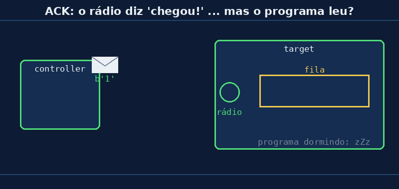

# Aula 07 — O ACK: o "recebido" do rádio

> *Baseado no trabalho de Noah Teodoro Ceiglinski Domingues · Revisão: Prof. Rogério Malta Branco*

---

## 🎯 Objetivos

Ao final desta aula você vai:

1. Saber o que é o **ACK** e o que significa o `True`/`False` do `send`.
2. Entender o que o ACK **garante** e o que ele **não garante**.
3. Saber por que é importante **ler a fila** com frequência.

> 💡 Esta é a **última aula da Seção 2**. Com ela, você terá entendido **todas as peças** do código da Aula 01!

---

## 💭 Conceito

### 1. Relembrando

Desde a Aula 01, o controller mostra isto:

```
[controller] enviei b'1' -> confirmado: True
```

Esse `True` vem do `send`:

```python
ok = e.send(TARGET_MAC, msg)
```

Mas **quem** confirmou? E confirmou **o quê**?

### 2. O comprovante de entrega 📦

Quando você compra pela internet, o entregador deixa o pacote na portaria e manda uma **foto de comprovante**: *"entregue!"*.

Isso quer dizer que o pacote **chegou no prédio**. Mas será que você **já abriu** o pacote? Não necessariamente! Pode estar lá na portaria até agora.

No ESP-NOW acontece igual:

| Na entrega | No ESP-NOW |
|---|---|
| O pacote chega na portaria | a mensagem chega no **rádio** do target |
| O entregador manda o comprovante | o rádio do target devolve um **ACK** |
| Você abre o pacote | o **programa** faz o `recv` |

**ACK** vem de *acknowledge*, que quer dizer "confirmar o recebimento". É o "chegou!" que o **rádio** do target manda de volta, sozinho, sem o programa precisar fazer nada.



### 3. O que o `True` e o `False` querem dizer

| `send` devolveu | Quer dizer | Exemplos |
|---|---|---|
| **`True`** | o **rádio** do target recebeu ✅ | target ligado e perto |
| **`False`** | o ACK **não voltou** ❌ | target desligado, longe demais, MAC errado, canais diferentes |

### 4. O que o ACK **NÃO** garante ⚠️

O `True` **não** quer dizer que o **programa** do target leu a mensagem. Ela pode estar:

- **esperando na fila** (Aula 06), porque o programa está ocupado, ou
- **perdida**, porque a fila **encheu**! A fila tem um tamanho limitado. Se chegarem mensagens demais e o programa não ler, as novas **são jogadas fora**, mesmo que o rádio já tenha mandado o ACK.

> 🔑 **Regra de ouro:**
> - `False` → com certeza **tem problema**.
> - `True` → **chegou no rádio**. Para ter certeza de que o **programa** fez o que você pediu, o target precisa **responder** (vamos fazer isso na Seção 4).

### 5. E se der `False`?

O mais simples é **tentar de novo**. Foi isso que o Noah fez no projeto da Seção 3: o controller tenta até 10 vezes. Isso se chama **retry**, e é o assunto da Aula 08.

---

## 🔌 Montagem

As duas placas, **sem** botão e **sem** LED: só os USBs.

---

## 💻 Código

### Target — [`aula07_target.py`](../codigos/aula07_target.py)

```python
DORMIR = 10        # segundos sem ler nada (mude no experimento!)

while True:
    print("[target] dormindo", DORMIR, "s... NÃO estou lendo nada!")
    time.sleep(DORMIR)

    lidas = 0
    ultima = None
    while e.any():
        mac, msg = e.recv(0)
        lidas = lidas + 1
        ultima = msg

    print("[target] acordei! li", lidas, "mensagens. A última foi:", ultima)
    print()
```

O target **dorme** sem ler nada. Quando acorda, **conta** quantas mensagens estavam na fila.

### Controller — [`aula07_controller.py`](../codigos/aula07_controller.py)

```python
contador = 0
confirmadas = 0

while True:
    contador = contador + 1

    ok = e.send(TARGET_MAC, str(contador))   # ok = o ACK chegou?
    if ok:
        confirmadas = confirmadas + 1

    print("[controller] enviei", contador, "-> ACK:", ok,
          "| confirmadas até agora:", confirmadas)

    time.sleep_ms(500)                       # manda 2 por segundo
```

O controller manda um número **a cada meio segundo** e conta quantos tiveram ACK.

### O que observar

Abra **duas janelas do Thonny**, uma para cada placa (ou observe uma de cada vez).

- No controller: os `ACK: True` aparecem **mesmo enquanto o target está dormindo**.
- No target: quando ele acorda, as mensagens estavam **guardadas na fila**.

---

## 🔬 Experimento

1. Rode os dois. Enquanto o target está "dormindo", o controller mostra `True` ou `False`? Por quê?
2. **Desligue o target** (tire o USB). O que aparece no controller? Ligue de novo: voltou?
3. Compare: em 10 s, o controller manda cerca de **20** mensagens. Quantas o target diz que leu?
4. No target, mude `DORMIR = 10` para `DORMIR = 60`. Quantas mensagens o controller confirmou nesse tempo? Quantas o target leu? **Os números batem?** Se não baterem, onde foram parar as outras?
5. Com base no item 4: dá para confiar **só** no `True` para saber se o target **fez** o que mandamos?

---

## 🏆 Desafio

**Principal:** no controller, conte também as mensagens **sem** ACK (`False`) e mostre a **porcentagem de sucesso**:
`confirmadas: 18 de 20 (90%)`

**Bônus:** junte com a Aula 02: leve o target para longe (corredor, outra sala) e anote a porcentagem de sucesso em cada lugar. Faça uma tabelinha "lugar × porcentagem".

---

## 📌 Resumo

- **ACK** = o "chegou!" que o **rádio** do target devolve sozinho.
- `send` → **`True`**: chegou no **rádio**. **`False`**: não chegou (desligado, longe, MAC errado…).
- O ACK **não garante** que o **programa** leu: a mensagem pode estar na fila…
- …ou ter se **perdido**, se a fila encheu. Por isso o target deve **ler a fila com frequência**.
- Se der `False`, o mais simples é **tentar de novo** (retry, na Aula 08).

---

### 🎓 Fim da Seção 2!

Agora você conhece **todas as peças** do código da Aula 01:

| Peça | Aula |
|---|---|
| `sta.active(False)` / `sta.active(True)` / `disconnect()` | 04 |
| `add_peer` | 05 |
| `send`, `recv`, `any` e a fila | 06 |
| o `True`/`False` do `send` (ACK) | 07 |

Volte no [código da Aula 01](aula01-botao-led-sem-fio) e leia de novo: agora você entende **cada linha**! 🎉

---

[← Aula 06 — send e recv: a fila](https://rogeriomb-hub.github.io/minicurso_06-embarcados/aulas/aula06-send-recv-fila) | [Início →](https://rogeriomb-hub.github.io/minicurso_06-embarcados/)
