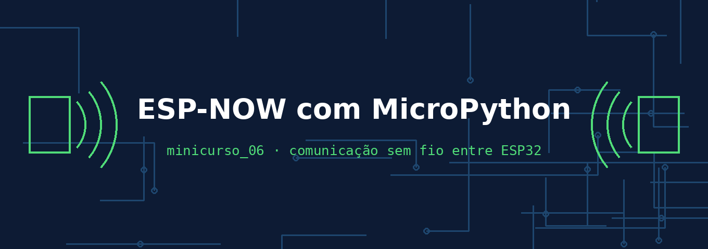

# Minicurso 06 — ESP-NOW com MicroPython

**Comunicação sem fio entre duas placas ESP32, sem roteador e sem internet.**

Começamos pelo clássico — **aperta o botão numa placa, acende o LED na outra** — e depois entendemos, com calma, cada peça do que aconteceu.

> 🛠️ **Aulas de bancada:** o Wokwi não simula ESP-NOW entre duas placas. Usamos hardware real (ESP32-C3 SuperMini).

## Seção 1 — Primeiro contato

| Aula | Tema |
|---|---|
| [Aula 01](https://rogeriomb-hub.github.io/minicurso_06-embarcados/aulas/aula01-botao-led-sem-fio) | Botão numa placa, LED na outra |
| [Aula 02](https://rogeriomb-hub.github.io/minicurso_06-embarcados/aulas/aula02-do-fio-para-o-ar) | O que aconteceu? Do fio para o ar |
| [Aula 03](https://rogeriomb-hub.github.io/minicurso_06-embarcados/aulas/aula03-endereco-mac) | O endereço MAC de cada placa |

## Seção 2 — Desmontando a Aula 01, peça por peça

| Aula | Tema |
|---|---|
| Aula 04 | Preparando o rádio *(em breve)* |
| Aula 05 | `add_peer`: a agenda de contatos *(em breve)* |
| Aula 06 | `send` e `recv`: a fila de mensagens *(em breve)* |
| Aula 07 | O ACK: o "recebido" do rádio *(em breve)* |

## Seção 3 — Projeto: controller e target

| Aula | Tema |
|---|---|
| Aula 08 | Tentar de novo: o retry *(em breve)* |
| Aula 09 | O target com LED RGB *(em breve)* |
| Aula 10 | RSSI e teste de distância *(em breve)* |

## Seção 4 — Confiabilidade

Resposta de volta, numeração de mensagens, criptografia e integração com CLP *(em breve)*.

---

### Créditos

- **Códigos-base, montagem e estudo do ESP-NOW:** Noah Teodoro Ceiglinski Domingues
- **Revisão técnica e pedagógica:** Prof. Rogério Malta Branco

Curso Técnico em Automação Industrial — IFRS Campus Rio Grande
